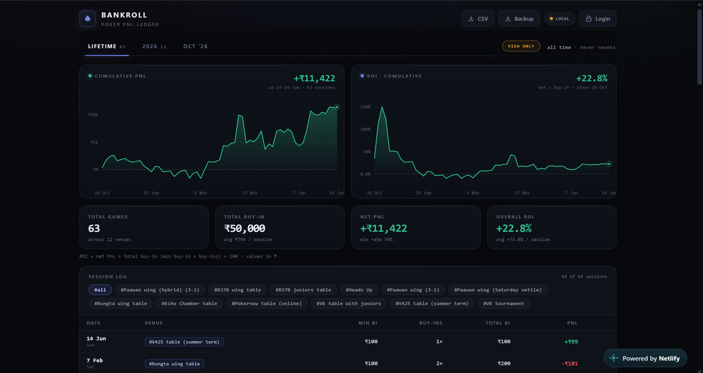

# ♠ BANKROLL — Poker PnL Ledger

**Track every poker session like a trading desk.** A single-file, zero-dependency web app that logs buy-ins, venues and net PnL — with cumulative PnL & ROI charting, auto-scoping time tabs, hashtag venue filters, cross-device cloud sync, and a view-only share mode guarded by an owner login.

🔗 **Live:** [sishtumm-ledger.netlify.app](https://sishtumm-ledger.netlify.app) *(shared view-only — edits are password-gated)*



---

## Why

Splitwise was my de-facto poker database for two years — expenses named `Poker`, `18 Nov table`, `split shift` scattered across five groups. This project turned that chaos into a real ledger: every session cleaned, deduplicated and imported from Splitwise exports, now tracked properly going forward.

## Features

**📊 Analytics**
- Cumulative PnL and cumulative ROI area charts — custom-built SVG charts with hover crosshairs, gradient fills and nice-tick axes (no chart library)
- KPI cards: total games, total buy-in, net PnL, overall ROI, plus **form analytics** — win rate (W/L), longest win streak with current streak, best/worst session, and max drawdown (peak-to-trough of the cumulative curve) — all re-scoped live by the venue chips
- Three auto-scoping tabs — **Lifetime**, **current year**, **current month** — that reset themselves when the calendar rolls over, computed from the clock on every render

**🃏 Tracking**
- Fast session logging: date, venue (free-text with history autocomplete), min buy-in, # of buy-ins, PnL — negatives allowed *only* where they belong
- Hotkey-driven (Linear-style): `N` new session · `1/2/3` tabs · `Esc` close
- Venue `#tag` chips filter the session log; per-row edit + two-step delete; totals footer
- CSV / JSON export, JSON import with ID-based dedup (used to backfill 50+ historical sessions from Splitwise data)

**☁️ Sync & sharing**
- Cloud sync via a Netlify Function + Netlify Blobs: last-write-wins with timestamp guard, self-healing offline latch, catch-up burst on load, 30s polling
- Works fully offline/local too — localStorage is the zero-config fallback, and everything merges when the cloud comes back
- **View-only share mode:** guests see the full dashboard but every write is rejected server-side (401). An owner **Login** unlocks edit mode — the password lives only in a Netlify env var, never in the page source

**🎨 Design**
- Trading-dashboard aesthetic: dark theme, mono tabular numerals, Linear-app-style modals, ₹ formatting with Indian digit grouping (₹1,23,456 / ₹1.2L / ₹3.4Cr)
- Fully responsive, runs offline, ~67 KB total. No frameworks, no fonts, no CDNs — one `index.html`

## Architecture

```
┌─────────────────────────────┐         ┌──────────────────────────────────┐
│  index.html (the whole app) │  GET/PUT│  netlify/functions/sessions.mjs  │
│  UI + charts + sync client  ├────────►│  validate · last-write-wins guard │
│  localStorage (offline 1st) │  POST   │  netlify/functions/auth.mjs      │
└─────────┬───────────────────┴────────►│  password check (env var only)   │
          │                              └────────────────┬─────────────────┘
          └───────────────────────────────────────────────▼
                                              Netlify Blobs (site store)
                                        single JSON ledger · survives deploys
```

- **Frontend:** vanilla HTML/CSS/JS in one file — no build step, no dependencies
- **Sync engine:** timestamped read-modify-write with optimistic local persistence, debounced push (600 ms), background pull, conflict-safe adoption
- **Backend:** two tiny Netlify Functions (~60 lines) over Netlify Blobs; deploys never touch stored data

## Deploy your own

1. **Drop** this folder on [Netlify](https://app.netlify.com/drop) — detects `package.json`, bundles the functions automatically
2. *(optional, for view-only sharing)* Netlify → *Site configuration → Environment variables* → add `BANKROLL_WRITE_KEY` = your password → trigger a redeploy
3. That's it. Sync activates on its own; without the env var the site runs open (login button hides)

Data format per session:

```json
{ "id": "pokernow-a1b2c3d4e5f6", "date": "2025-10-18",
  "venue": "Pokernow table (online)", "minBuyIn": 500, "buyIns": 2,
  "pnl": -1000, "createdAt": 1791749459958 }
```

ROI is defined as net PnL ÷ total buy-in (min buy-in × buy-ins) — cumulative across every session.

## Roadmap

- [ ] Stakes/game-type fields (cash vs tourney, blinds) with per-tag analytics
- [ ] bb/100 and hourly-rate KPIs
- [ ] Optional per-user accounts (Netlify Identity) instead of shared-password gate

---

### A note on authorship

Specs, features and iteration direction are mine; the implementation was pair-written with an AI agent (Arena.ai Agent Mode). Every release was steered, reviewed and battle-tested by hand — it did the typing, I did the steering.

*Vanilla JS + Netlify primitives underneath. Feel free to fork — keep the chips friendly.* ♠
